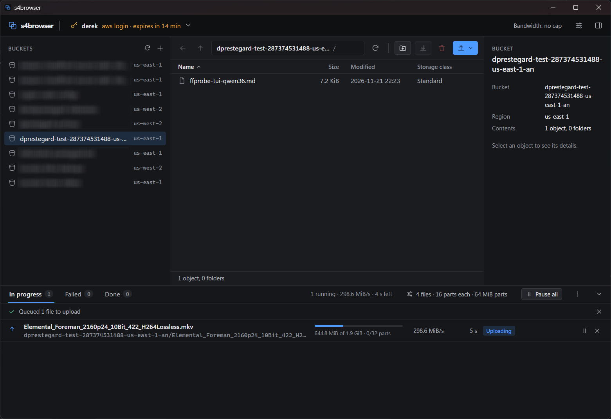

# s4browser



A desktop client for Amazon S3 on Windows and macOS, built for moving very large media files quickly. You browse buckets, drag files and folders in from Explorer or Finder, download files and folders, and watch a transfer queue that retries on its own. It also deletes objects, creates folders, shares presigned links and edits tags.

It is a [Wails v3](https://v3.wails.io) app: a Go backend and a React frontend shown in the operating system's own web view, not a bundled browser. That is **Microsoft Edge WebView2** on Windows and **WKWebView** (WebKit) on macOS, so the app is small, but the page has to work in both engines.

## Install

### Windows

1. Copy `s4browser.exe` to any folder. There is no installer, and nothing is written next to the exe.
2. Run it.

It needs the Microsoft Edge WebView2 runtime. Windows 11 includes it, and so do Windows 10 machines kept up to date. On a machine without it, the exe offers to download it. (The Mac build needs nothing extra: WKWebView is part of macOS.)

The app keeps its data in your user profile:

| Path | What |
|---|---|
| `%AppData%\s4browser\profiles.json` | Profile names, regions, the active profile. No keys |
| `%AppData%\s4browser\buckets.json` | Buckets added by name, per profile |
| `%AppData%\s4browser\transfer-settings.json` | Transfer settings |
| `%AppData%\s4browser\journal.json`, `journal.lock` | Unfinished multipart uploads and download temp files, so they can be cleaned up after a crash. No secrets |
| `%AppData%\s4browser\filedrop.log` | Paths dropped on the window |
| `%AppData%\s4browser.exe\` | WebView2's cache |
| Windows Credential Manager, `s4browser:profile/<name>` | Access keys you add in the app |

### macOS

1. Copy `s4browser.app` to Applications (or anywhere).
2. The app is signed ad hoc, not by an Apple developer ID, so Gatekeeper blocks a copy that came from another Mac or a download. Clear the quarantine flag once, then open it:

   ```bash
   xattr -dr com.apple.quarantine /Applications/s4browser.app
   ```

Its data is in `~/Library/Application Support/s4browser/` (the same files as on Windows), the WKWebView cache in `~/Library/WebKit/com.dprestegard.s4browser` and `~/Library/Caches/com.dprestegard.s4browser`, and access keys you add in the login Keychain as generic passwords, service `s4browser`, account `profile/<name>`.

Only one copy of the app runs at a time. A second copy is refused, because it would clean up the first one's uploads.

## Credentials

The profile menu at the top left lists:

- **Profiles from your AWS files** (`~/.aws/config` and `~/.aws/credentials`, or `AWS_CONFIG_FILE` and `AWS_SHARED_CREDENTIALS_FILE`):
  - static keys
  - session keys written by a sign-in tool
  - `credential_process` helpers, which run hidden and run again a minute before their credentials expire
  - profiles signed in with `aws login` (`login_session`), which refresh themselves from the AWS CLI's token cache
  - roles (`role_arn`) that use an `aws login`, static-key or session profile as their `source_profile`. A role with `mfa_serial` is not supported.

  When an `aws login` session has expired, the profile says which `aws login --profile <name>` to run. Run it, then choose "Load credentials again". SSO, web-identity and `credential_source` profiles, and roles over a `credential_process` profile, are listed but not supported.
- **Access keys you add** with "Add access keys…". The secret goes to Windows Credential Manager or the macOS Keychain, never to a file.

One profile is active at a time. When a profile's credentials expire during a transfer, the transfer waits with the reason shown. Other profiles' transfers keep going. When you sign in again and choose "Load credentials again", the transfer continues where it stopped. It also resumes on its own if the profile's helper starts handing out working credentials.

## Using it

- **Buckets:** the bucket list shows every bucket the profile can list. A role that cannot list buckets can add one by name with **+**. Each bucket's region is detected.
- **Browsing:** a folder of up to 1,000,000 objects loads in the background and scrolls without delay. Sort by name, size, date or storage class. Select with click, Shift, Ctrl and Ctrl+A (⌘ and ⌘A on a Mac). Backspace goes up a folder. F5, Ctrl+R (⌘R) or the reload button reloads the folder and keeps the selection.
- **Uploads:**
  - Drop files and folders from Explorer or Finder on the listing, or use Upload. A drop asks before it starts.
  - Folders upload with everything inside them.
  - An object with the same key is replaced.
  - The listing updates as uploads finish into the folder on screen.
- **Downloads:** select objects or folders and choose Download. A file that already exists locally is never overwritten. Names Windows cannot hold are refused, and so are paths longer than 259 characters. The download report lists what was refused and why.
- **Transfer queue:** pause, resume, cancel, retry and clear, per job or for all. Failed parts are retried automatically, and a broken connection resumes inside a part. Transfer settings:
  - files at once (default 4)
  - parts per file (16)
  - parts in total (32)
  - part size (64 MiB, raised automatically for very large files)
  - upload and download bandwidth caps.
- **Delete:** the dialog counts everything that will be deleted first and says what versioning means for the bucket. Deleting 100 objects or more asks you to type `delete`. In a versioned bucket a delete adds delete markers, and the old versions stay and keep costing money.
- **New folder** creates an empty `name/` object.
- **Details panel:** metadata, including checksum, encryption and version, plus tags (view and edit) and **Share link** (a presigned download link valid for 15 minutes to 7 days, shortened if the credentials expire sooner).

Closing the app while transfers run asks first. Closing cancels them and aborts their multipart uploads on S3.

## Known limits

- **No resume after closing.** Transfers continue only while the app is open. After a crash, the next launch aborts unfinished multipart uploads and removes partial downloads.
- **Downloads are not checked against S3's stored checksum.** Each part is fetched with `If-Match` on the object's ETag, and its range and the total size are checked, over TLS. A download is not compared end to end with the object's CRC32. Uploads are: each part carries a CRC32, and S3's composite checksum must match.
- **A full drive pauses a download.** Free space, then resume.
- **Downloads follow Windows name rules on every system,** so a downloaded folder can be copied to a Windows machine as it is. On a Mac, keys with names such as `CON`, a trailing dot, `<>:"|?*`, or a full path over 259 characters are refused too.
- **On exFAT and FAT32 volumes (Mac),** which have no hard links and no exclusive rename, a finished download is moved to its name after checking that the name is free. That is not atomic: if another program creates the same file in that instant, it is replaced. APFS, HFS+ and NTFS are not affected.
- **macOS: keys are uploaded with names as the file system gives them.** Names are not normalized to NFC, so a name with accents can get a different key from a Mac than from Windows.
- **Session-key profiles have no automatic refresh.** Sign in again with your tool, then use "Load credentials again".
- No S3-compatible endpoints, ACLs, versioning UI, rename, copy, storage-class change or restore from Glacier.

## Building from source

Requirements: Go 1.27, Node.js 26 LTS, and the Wails v3 CLI (`go install github.com/wailsapp/wails/v3/cmd/wails3@v3.1.0`; only needed for the Windows resource file and for regenerating the bindings). On a Mac, also the Xcode Command Line Tools (`xcode-select --install`).

Build the frontend first, because `main.go` embeds `frontend/dist`:

```powershell
cd frontend; npm ci; npm run build; cd ..
```

Windows (the `.syso` holds the icon, manifest and version; it is git-ignored):

```powershell
wails3 generate syso -arch amd64 -icon build/windows/icon.ico -manifest build/windows/wails.exe.manifest -info build/windows/info.json -out wails_windows_amd64.syso
go build -tags production -trimpath -buildvcs=false -ldflags "-s -w -H windowsgui" -o build/bin/s4browser.exe
```

macOS (Go 1.27 needs a deployment target of 13):

```bash
export CGO_ENABLED=1 CGO_CFLAGS=-mmacosx-version-min=13.0 CGO_LDFLAGS=-mmacosx-version-min=13.0
go build -tags production -trimpath -buildvcs=false -ldflags "-s -w" -o build/bin/s4browser
APP=build/bin/s4browser.app
mkdir -p $APP/Contents/MacOS $APP/Contents/Resources
cp build/bin/s4browser $APP/Contents/MacOS/ && cp build/darwin/Info.plist $APP/Contents/ && cp build/darwin/icons.icns $APP/Contents/Resources/
codesign --force --deep --sign - $APP
```

For Intel Macs too, build with `GOARCH=amd64` and `GOARCH=arm64` and join them with `lipo -create` (CI does this). The version is in `build/windows/info.json`, `build/darwin/Info.plist` and the manifest; keep them equal. The icons are drawn from `build/appicon.png` with `wails3 generate icons -input build/appicon.png -macfilename build/darwin/icons.icns -windowsfilename build/windows/icon.ico`.

The frontend calls Go through generated bindings in `frontend/bindings`, which are committed. After changing the exported methods or types of `internal/app`, regenerate them: `wails3 generate bindings -d frontend/bindings -ts`.

### CI builds

`.github/workflows/build.yml` runs the checks below and then builds `s4browser-<version>-windows-amd64.exe` and `s4browser-<version>-macos-universal.zip` on GitHub's Windows and macOS runners, so a Mac build does not need a Mac. It runs only when started by hand (Actions ▸ build ▸ Run workflow, or `gh workflow run build.yml`) or when a `v*` tag is pushed, because macOS minutes in a private repo bill at 10x. The builds are the run's artifacts. A tag must match the version in `build/windows/info.json` (tag `v0.0.2` for `0.0.2`), and it also creates a draft GitHub Release with both files, which you publish yourself.

### Development

Start the Vite dev server, then the app pointed at it:

```powershell
cd frontend; npm run dev
$env:FRONTEND_DEVSERVER_URL = "http://localhost:5173"; go run .
```

To run against an in-process fake S3 with no AWS access, build with the `devfake` tag:

```powershell
$env:FRONTEND_DEVSERVER_URL = "http://localhost:5173"; go run -tags devfake .
```

On a Mac, set the variable the shell way (`FRONTEND_DEVSERVER_URL=http://localhost:5173 go run .`) and export the `CGO_*` variables from the build above first.

Tests (the race detector needs a C compiler, such as WinLibs on Windows or the Command Line Tools on a Mac, and `CGO_ENABLED=1`):

```powershell
go test -race ./...
```

Also run `go vet ./...`, `staticcheck ./...`, `npx tsc --noEmit` in `frontend`, and `go run ./tools/notices -check` (see License).

### Test tooling

- **`cmd/s4engine`:** a command-line transfer tool on the same engine. It writes only under `<root><run-id>/` (default `s4browser-test/`) and has no flag that turns this off.
- **`cmd/s4credtest`:** a `credential_process` helper for testing credential expiry.
- **`S4_WRITE_PREFIX`:** when set, for example to `upload-test/run-1/`, the app refuses every upload, delete, new folder and tag change outside that prefix. Use it for verification against a real bucket.

## License

s4browser is released under the [MIT License](LICENSE).

It contains third-party software under MIT, BSD-2-Clause, BSD-3-Clause, ISC, Apache-2.0 and Unlicense-or-MIT terms, none of them copyleft. [THIRD_PARTY_NOTICES.txt](THIRD_PARTY_NOTICES.txt) lists each component with its license text and the NOTICE files the Apache-2.0 components require. Both files are embedded in the app and shown under View settings ▸ Licenses…, so the single-file Windows exe carries them too.

After changing Go or npm dependencies, or the Go version, regenerate the notices (needs `frontend/node_modules`):

```bash
go run ./tools/notices
```

`go test ./tools/notices` fails while a linked module or bundled npm package is missing from the file, and `go run ./tools/notices -check` fails if the file differs in any way. Run the check before a release build.

## Documentation

- [docs/roadmap.md](docs/roadmap.md): planned work (Mac release, VPC endpoints).
- [docs/engine-design.md](docs/engine-design.md): the transfer engine's normative design.

The original implementation plan, the per-stage progress notes and the stage 4.1 engine review were removed from the tree. They are in the git history (`git log --diff-filter=D --name-only -- docs`).
